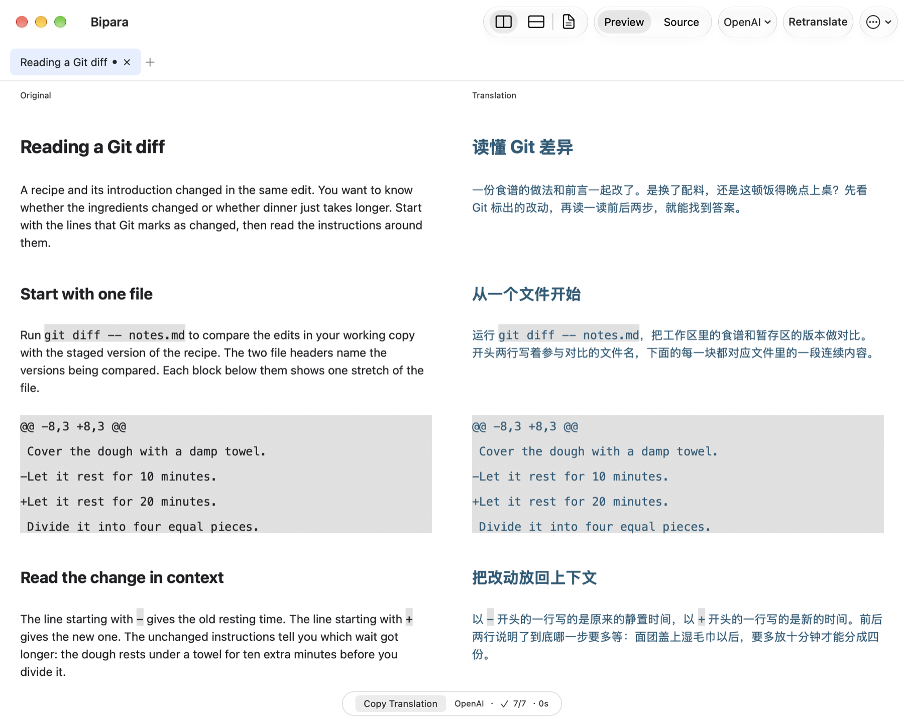

# Bipara

English · [简体中文](README.zh-CN.md) · [Changelog](CHANGELOG.md)

Bipara is a native macOS app that uses large language models to translate long documents for bilingual reading. It currently supports only **English to Chinese** and **Chinese to English**. Paste an article, translate it with the model you configure, and read both languages side by side.



*Source build preview. A Git guide explains a change to a recipe. Both columns show the exact lines the author added and removed.*

## Reading with Bipara

- **Follow the same passage in two languages.** Scroll the paired columns together, or alternate the original and translation paragraph by paragraph. In the source build, switch one tab to Translation Reader for an uninterrupted read. Switch back when a sentence needs a closer look.
- **Read technical guides without losing the example.** Open a Markdown file or paste the text in the source build. Headings, lists and tables keep their structure. Commands inside backticks and fenced code blocks stay intact, and translated link labels still point to the original destination.
- **Pick up a long article tomorrow.** Save it as a `.bipara` document with its source, translation and reading position. Reopen it offline to read completed passages. If you paused halfway through, resume the remaining work with the matching model connection.
- **Keep several articles open.** Let one tab translate while you read another. Each tab keeps its own progress and failure details. In the source build, copy a completed translation or export a translated Markdown file for your notes.

We can add more language pairs as people need them, using the same translate-and-read workflow. To suggest a pair, tell us which languages you read and what you would like to translate. [Request a language pair](https://github.com/willaaaaaaaaa/bipara/issues/new?template=feature_request.md)

## Install

Choose the DMG for your Mac's chip. The release page lists macOS requirements, checksums, and tested configurations. [Download Bipara for macOS](https://github.com/willaaaaaaaaa/bipara/releases/latest)

The app bundles Python. For installation, upgrades, and macOS security prompts, see [installation and trust](docs/releasing.md#install-and-publish).

## Your first translation

1. Open **Settings → Models → Add** and enter your connection details. On a fresh source build the list starts empty, so the first model you add becomes active. If the list already contains entries, choose yours under **Active Model**, then save Settings.
2. Click **+**, paste an article, and choose **Translate**. You can also open a UTF-8 `.txt` file. The source build also opens `.md` files and recognizes pasted Markdown.
3. Read the two columns together, or switch to alternating paragraphs. Changing layouts keeps your place and uses the translation you already have. Save a `.bipara` document to reopen both texts and the completed work later.

Bipara stores your API key in macOS Keychain. Translation sends text and nearby context to the endpoint you configure, which may charge for requests. Saved documents stay on your Mac. [Privacy](PRIVACY.md)

## Run from source

Current source targets macOS 14.0 or later on Apple silicon and compatible Intel Macs. To build, use full Xcode 26.6 or later, Python 3.12+ for tooling and [uv](https://docs.astral.sh/uv/). The first build downloads the pinned Swift and Python dependencies and bundles the Python 3.13 worker.

```sh
script/build_and_run.sh
```

To contribute, start with [local setup and checks](CONTRIBUTING.md#local-setup-and-checks). For a requested offline acceptance run, use `script/check.sh`. For a local development DMG, use `script/build_dmg.sh --development`. [Test instructions](Tests/README.md) · [Architecture](docs/architecture.md) · [Validation status](docs/validation.md)

Bipara is experimental. Real-provider translation quality and complete accessibility coverage are still being evaluated. For help or bug reports, see [Support](SUPPORT.md). For private reports, see [Security](SECURITY.md).

## License

Bipara is [MIT licensed](LICENSE). Bundled dependencies retain their [third-party notices](Worker/THIRD_PARTY_NOTICES.md).
