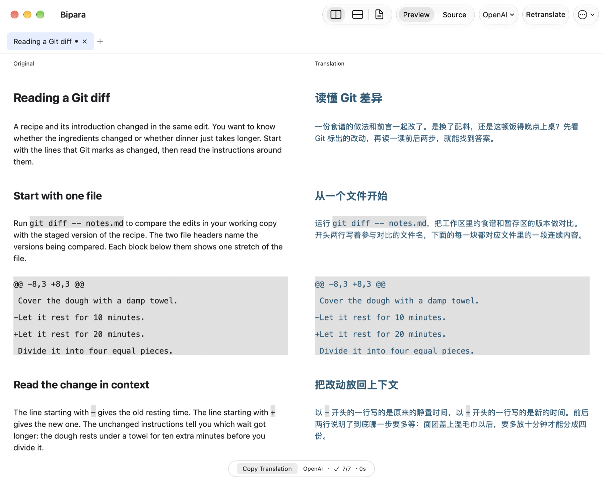

# Bipara

[English](README.md) · 简体中文 · [更新日志](CHANGELOG.md)

Bipara 是一款由大语言模型驱动的原生 macOS 长文翻译与双语阅读应用，目前仅支持**英译中**和**中译英**。粘贴一篇文章，用你配置的模型翻译，就能把原文和译文放在一起读。



*源码版预览。文中的 Git 示例修改了一份食谱，两栏都保留了原样的增删行，可以对着译文读懂这次改动。*

## 用 Bipara 读长文

- **对着原文读，或专心读译文。** 左右两栏同步滚动，也可以让原文、译文逐段交替显示。源码版还可以把当前标签切到「译文主栏」，一路读下去，遇到值得推敲的句子再切回对照。
- **读技术文档时，命令和示例都在原处。** 源码版可以打开 Markdown 文件，也能识别粘贴的 Markdown。标题、列表和表格保留结构，行内命令和代码块保留原文，翻译后的链接仍指向原来的地址。
- **长文章可以留到明天。** 保存为 `.bipara` 文档后，原文、译文和阅读位置一起保存在本机。下次打开就能离线阅读已完成的段落。如果上次只翻了一半，用同一模型配置就能接着翻。
- **一篇在翻，另一篇照常读。** 每个标签都有自己的翻译进度，出错时可以回到对应标签查看详情。源码版还可以一键复制完整译文，或把译文导出成 Markdown，放进自己的笔记。

后续可以按需求增加其他语言，沿用同样的翻译和对照阅读方式。欢迎告诉我们你想从哪种语言译到哪种语言，以及平常会读什么材料。[提交语言支持需求](https://github.com/willaaaaaaaaa/bipara/issues/new?template=feature_request.md)

## 安装

在发行附件中选择与你的 Mac 芯片相符的 DMG。系统要求、校验和及验收范围见对应的发行页。[下载 macOS 版 Bipara](https://github.com/willaaaaaaaaa/bipara/releases/latest)

应用已内置 Python。安装、升级及 macOS 安全提示的处理方式见[安装与信任说明](docs/releasing.md#install-and-publish)。

## 第一次翻译

1. 打开 **设置 → 模型 → 添加**，填写模型和连接信息。全新安装的源码版从空列表开始，添加的第一个模型会自动选中。如果列表里已有其他配置，在「使用模型」中选中你刚添加的那一项，然后保存设置。
2. 点 **+**，粘贴文章，再点 **翻译**。也可以打开 UTF-8 的 `.txt` 文件。源码版还支持打开 `.md` 文件，或直接识别粘贴的 Markdown。
3. 左右对照阅读，或切换为原文、译文逐段交替显示。切换会保留阅读位置，无需重新翻译。保存为 `.bipara` 文档后，下次打开仍能读到原文和已经完成的译文。

API 密钥保存在 macOS 钥匙串中。翻译时，Bipara 会把原文片段和相邻上下文发送到你配置的服务地址，服务商可能收取费用。保存的文档留在本机。[隐私说明](PRIVACY.md)

## 从源码运行

当前源码以 macOS 14.0 及以上为目标，适用于能运行相应系统的 Apple 芯片和 Intel Mac。构建需要完整的 Xcode 26.6 或更高版本、供工具脚本使用的 Python 3.12+ 和 [uv](https://docs.astral.sh/uv/)。首次构建会下载锁定版本的 Swift 和 Python 依赖，并将 Python 3.13 worker 打入应用。

```sh
script/build_and_run.sh
```

参与开发请先阅读[本地设置与检查](CONTRIBUTING.md#local-setup-and-checks)。需要运行离线验收时使用 `script/check.sh`，制作本地开发 DMG 使用 `script/build_dmg.sh --development`。[测试说明](Tests/README.md) · [架构](docs/architecture.md) · [验证状态](docs/validation.md)

Bipara 仍处于实验阶段。真实模型的翻译质量和完整的辅助功能体验仍在验证中。使用问题和缺陷报告见[支持](SUPPORT.md)，安全问题见[私下报告方式](SECURITY.md)。

## 许可证

项目自有代码采用 [MIT 许可证](LICENSE)。随应用分发的依赖保留各自的[第三方许可声明](Worker/THIRD_PARTY_NOTICES.md)。
