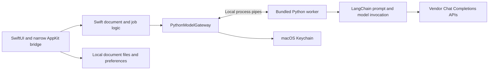

# Architecture

## Decision status

| Topic | Current decision |
| --- | --- |
| Product | Native macOS app first; keep future iPhone/iPad adaptation possible |
| Local execution | App-owned logic; no separately deployed server, HTTP listener, or daemon |
| Languages/runtime | Swift + app-bundled Python child process over pipes |
| Providers | OpenAI and GLM baseline. The 2026-11-06 revision adds Kimi and DeepSeek through the same worker boundary, with editable Base URLs, model-specific effort and explicit request profiles. |
| Framework | LangChain first; explicitly authored LangGraph orchestration deferred |
| UI | Approved reading/Settings/multiple-tab direction; English-default interface; System-default appearance with Light/Dark overrides |
| Implementation baseline | macOS 14+, Swift 6, arm64 private acceptance, CPython 3.13; detailed contracts linked below |
| Validation | Native app and packaged worker run on the development machine; M0 feasibility passed, M1 native acceptance partial; see [current evidence](validation.md) |
| Distribution | MIT; tagged formal DMGs; Intel/mobile and App Store qualification remain separate |

The bundled process trades additional packaging/signing work for a narrow provider boundary. iOS/iPadOS will need a separately evaluated execution layer. Packaging feasibility and distribution qualification are separate.

## Ownership and flow

Swift owns source identity, segmentation, whole-document scheduling, task state, validation of native ranges, local files, and UI. Python owns a single model operation: prompt composition, provider call, structured-output validation, and normalized results/errors. There is one authoritative document workflow, not parallel Swift/Python engines.

`ModelGateway` has two operations: translate a bounded batch and analyze a selection against existing translated text. Its real adapter owns child-process/credential details; a fixture adapter supplies deterministic tests. Versioned profiles encapsulate concrete differences in provider parameters and output modes. No planner, tools, agent team, generic plugin platform, message queue, or database is needed.

Global preferences are independent of document state. Jobs retain provider/model/prompt snapshots. Every async result is tied to its tab session, document revision, job/attempt and request. Both layouts read the same canonical text and correspondence data. Hover is local; only eligible committed selections may request additional analysis.

The approved [model configuration revision](design/model-settings.md) adds frozen endpoint/effort and private credential bindings to runtime job snapshots. It uses the existing worker and LangChain boundary, preferences schema 2, pipe protocol 2 and portable document schema 2 with v1 reading compatibility. The 2026-11-06 revision extends the same boundary with two profiles and keeps the existing prompt assets. Validate the revised behavior independently of earlier runtime results.

## Detailed contracts

| Owner document | Contents |
| --- | --- |
| [Native application](design/technical-design.md) | Modules, state, concurrency, AppKit boundary, Settings, appearance, credentials and packaging |
| [Model configuration](design/model-settings.md) | Model CRUD, active selection, vendor catalog, effort capabilities, endpoint/credential binding and preferences migration |
| [Model workflow](design/model-workflow.md) | Pinned trial dependencies, provider defaults/parameters, segmentation, commit, alignment and retry rules |
| [Worker protocol](design/worker-protocol.md) | Exact pipe frames, typed errors, cancellation, deadlines and process lifetime |
| [Document format](design/document-format.md) | Versioned local file fields, example, validation and compatibility |
| [Prompt assets](../prompts/README.md) | Complete system prompts, schemas, message composition and synthetic evaluation corpus |
| [Development plan](development-plan.md) | Implementation sequence, milestones, commands and contract escalation |
| [Self-test plan](testing.md) | Automated/native/live/package checks, requirement traceability and evidence expectations |

Design and prompt changes update their owning contracts and acceptance checks before implementation.

## First framework feasibility task

M0 in the development plan proves the approved pipe worker as a **packaged app component** early, including dependency assets, lifecycle, cancellation, and a copied bundle without developer Python. Use PyInstaller onedir as the selected first packaging mechanism. Record actual versions, notices, size, cold/warm start, memory and process behavior in the [native integration report](validation.md).

A test-only direct-call baseline compares equivalent model requests with LangChain in M4. Do not ship both paths. If measured complexity is high **and** benefit is limited, apply the owner's [complexity rule](design-principles.md#complexity-decisions) before continuing beyond the already approved scope; do not infer that every hard implementation detail needs new permission.

The runtime must not install packages or require Python from the end user's system. Packaging failures cannot justify an unapproved server, daemon, additional language, or embedded-interpreter rewrite. Real calls, clean-machine behavior, signing/notarization and native UI remain distinct evidence gates.

## Future boundaries

Keep reusable text/domain logic free of AppKit and LangChain objects. A future mobile version can retain Swift models, prompts, and provider contracts, but `Process`-based execution is not a promised mobile implementation. A service or another runtime needs a future design decision.

Add a provider only through a small profile/factory plus contract tests. Add LangGraph only for a demonstrated branching/resumption requirement the existing workflow cannot reasonably handle. "LangGraph later" means explicitly authored graph orchestration; record actual transitive packages rather than pretending an indirect dependency is an authored application graph.

Public dependency facts, model protocol contracts, asset provenance, and portable build instructions stay in this repository. Private remote addresses, internal middleware and operator-specific setup belong in the owner's KB. Secrets remain in Keychain or a dedicated secret store. Follow [repository boundaries](repository-boundaries.md).
